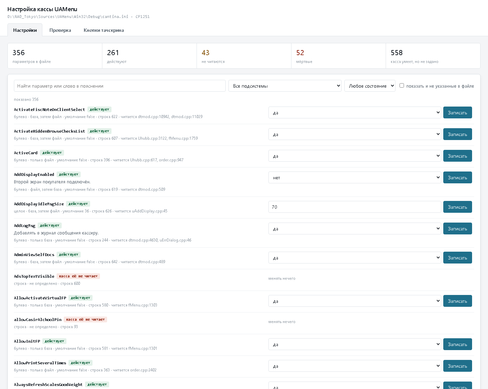
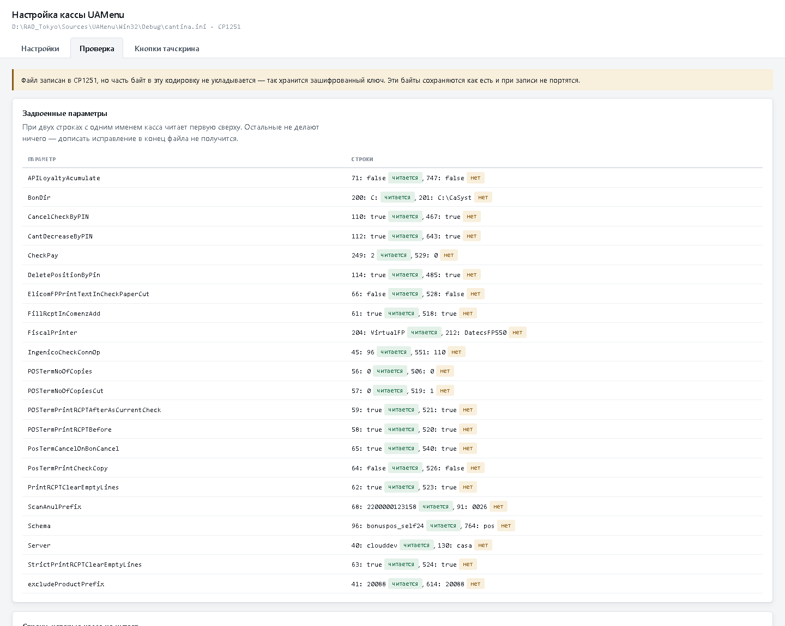
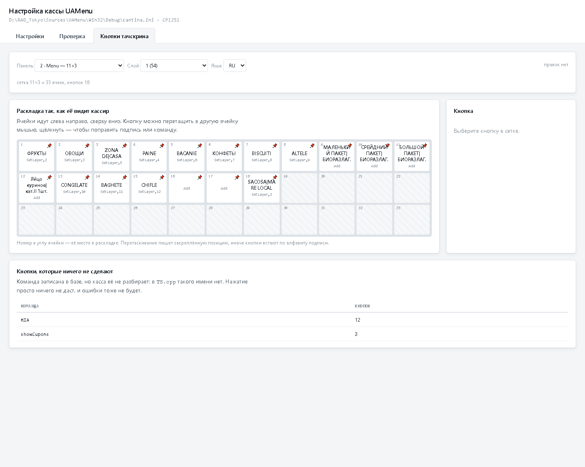
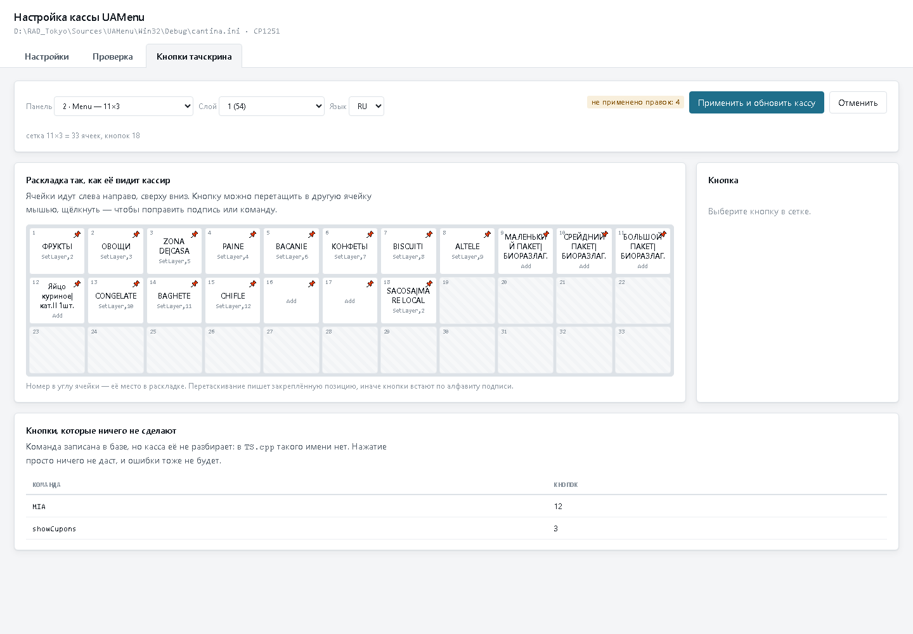

# Утилита настройки кассы

Настройка UAMenu без правки файла в блокноте. Показывает не только то, что
записано, но и то, чего из файла не видно: читает ли касса эту строку, откуда
она вообще берёт значение и что будет, если строку убрать.

```bash
python -m cfgtool web        # окно настройки на 127.0.0.1:8920
```

Полный справочник по всем параметрам — [docs/cantina-ini.md](../docs/cantina-ini.md),
он собирается этой же утилитой из исходников кассы.

---

## Зачем она нужна

Файл `cantina.ini` выглядит простым, и именно поэтому с ним ошибаются. Три
случая встречаются постоянно.

**Правку дописывают в конец файла.** А при двух строках с одним именем Windows
читает **первую сверху**. В рабочем файле так задвоено 22 параметра, и у
четырёх из них значения разные: `Server` — `clouddev` побеждает `casa`,
`FiscalPrinter` — `VirtualFP` побеждает `DatecsFP550`, `CheckPay` — `2`
побеждает `0`, `IngenicoCheckConnOp` — `96` побеждает `110`.

**Правят строку, которую касса не читает.** Таких строк 43: часть отключена
решёткой, часть перебита дублем.

**Правят параметр, которого в кассе нет.** Таких имён 52 — они не встречаются
ни в одном исходнике ни как параметр, ни как строковый литерал.

Утилита показывает всё это сразу, рядом с параметром.

---

## Окно настройки

### Настройки

Каждый параметр с тем, что о нём известно из кода: тип, порядок обращения к
файлу и базе, значение по умолчанию, место чтения в исходниках. Булевы
значения правятся выбором «да/нет», значения с известным списком — выбором из
списка, остальные — строкой. Поиск идёт и по имени, и по пояснению.



Флажок «показать и не указанные в файле» добавляет 558 параметров, которые
касса читать умеет, но в файле их нет. Их достаточно дописать, чтобы изменить
поведение.

### Проверка

Задвоенные строки с указанием, какая из них читается. Строки, которые касса не
видит. Мёртвые параметры. Здесь же сказано, если часть байт файла не
укладывается в его кодировку — так в нём хранится зашифрованный ключ.



### Кнопки тачскрина

Раскладка панели так, как её видит кассир: сетка нужного размера, кнопки в
своих ячейках, подпись и команда на каждой. Кнопка перетаскивается мышью в
другую ячейку, щелчок открывает правку подписи и команды.



Отдельно показаны кнопки, которые ничего не сделают: команда в базе записана,
а касса такого имени не разбирает. В рабочей базе таких 15 — двенадцать с
командой `MIA` и три с `showCupons`.



### Картинка на кнопке

Картинку можно дать любой кнопке, а не только кнопке товара. Файл выбирается
в форме правки кнопки, показывается тут же и попадает в сетку — ровно так, как
его покажет касса.

Картинка ужимается при загрузке: сторона не больше 256 точек, вес не больше
120 КБ. Прозрачность сохраняется — значку на цветной кнопке она нужна. Это не
придирчивость: фотографии товаров в этой базе весят в среднем 500 КБ, самая
большая 21,9 МБ, а всего их 66 МБ, и касса тянет их одним запросом целиком.
Для кнопки размером в пару сантиметров это бессмысленно.

Три вещи, о которых утилита предупреждает сама:

* **картинка лежит не у кнопки, а у записи содержимого**, и запись бывает
  общей. В рабочей базе 47 таких записей, одну делят 16 кнопок — картинка
  появится на всех, и об этом сказано до записи;
* **у некоторых кнопок записи содержимого нет вовсе** — тогда картинку класть
  некуда, и утилита говорит это прямо, а не молчит;
* **если у кнопки нет своей картинки**, касса покажет фотографию товара, как
  и раньше.

---

## Что надо знать про правку кнопок

Кнопок нет в коде кассы: они лежат в базе, а форма только рисует их. Но лежат
не там, где касса их читает, и это меняет всё.

**Касса читает материализованные представления над чужой схемой.** `VTS_BUTTONS`,
`VTS_INTERFACE`, `VTS_LAYERSH` в схеме кассы — копии таблиц из `BONUS2019_07`.
Писать в них нельзя, Oracle отвечает `ORA-01732`. Та же граница, что у цен, см.
erp-price-boundary.md.

**Настоящие таблицы — в мастере**, и запись в них у нас есть. Утилита пишет
туда через связь баз.

**Команда не пишется строкой.** Колонку `INTERNAL_CMD` заполняет триггер из
справочника: номер команды плюс два параметра. Поэтому в окне команда
выбирается из списка, а не вписывается текстом.

**Позиция в сетке — вычисляемая.** Порядок считается так: сначала кнопки с
закреплённой позицией, затем остальные по алфавиту подписи. Перетаскивание
закрепляет позицию — иначе кнопка уедет обратно, как только сменится подпись.

**Касса увидит правку не сразу.** Между мастером и кассой стоят
материализованные представления. Кнопка «Применить» записывает правки и тут же
обновляет представления.

До применения правки живут в незавершённой транзакции: их видно в окне, но не
в кассе, и «Отменить» возвращает всё как было. Предпросмотр считается по тому
же правилу сортировки, что и в базе, поэтому показывает именно то, что
получится.

---

## Командная строка

```bash
python -m cfgtool get Style            # значение и всё, что о нём известно
python -m cfgtool set Style TS         # записать
python -m cfgtool list MIA             # параметры по подстроке
python -m cfgtool check                # что в файле не так
python -m cfgtool buttons              # панели тачскрина
python -m cfgtool buttons 3 1 RU       # раскладка панели в виде сетки
python -m cfgtool scan                 # пересобрать справочник из исходников
python -m cfgtool doc                  # пересобрать docs/cantina-ini.md
```

Файл задаётся первым аргументом или переменной `UAMENU_INI`; по умолчанию
берётся `Win32/Debug/cantina.ini`.

`buttons` рисует раскладку прямо в терминале, отмечая `!` кнопки с непонятной
кассе командой:

```
панель 3 · сетка 3x5 · слой 1 · язык RU · кнопок 15

 Поиск                | Кол-во               | Ещё
  З                   |  +                   | Удалить
  И                   |  -                   |  Отменить|чек
 Наличные             | Оплата|картой        | Ящик
 Сохранить|чек        |!MIA                  |!Купон
```

---

## Как это устроено

| Файл | Что делает |
|---|---|
| `inifile.py` | файл настроек: чтение и запись без потери комментариев, порядка строк и кодировки |
| `scan.py` | сбор параметров из исходников кассы в `catalog.json` |
| `descriptions.py` | пояснения на русском: к чему относится параметр и что значит |
| `catalog.py` | сведение трёх источников в одну картину по каждой настройке |
| `docgen.py` | сборка `docs/cantina-ini.md` |
| `tsbuttons.py` | кнопки тачскрина: чтение раскладки и правка в мастере |
| `web.py`, `ui/` | окно настройки |

### Правка файла ничего не портит

Правило одно: всё, чего не трогали, остаётся байт в байт. Комментарии, порядок
строк, разделители из минусов, отступы, пустые строки, вид переводов строк,
кодировка. Перед записью рядом кладётся копия `.bak`.

Кодировка определяется по содержимому, а не назначается. Порядок проб здесь не
работает: однобайтовые кодировки принимают почти любые байты, поэтому
«успешно» прочитанный файл ещё ничего не доказывает. Рабочий `cantina.ini`
этому и научил — он в CP1251, но внутри значения `APIKey=ENC:…` лежат байты,
которых в CP1251 нет. Строгое чтение в CP1251 падает, строгое чтение в CP866
проходит и выдаёт вместо русских комментариев псевдографику. Выбор по первой
удавшейся пробе дал бы CP866 и испортил бы файл при первой же записи. Поэтому
кодировка выбирается по тому, сколько получилось осмысленного текста, а байты,
не уложившиеся в неё, сохраняются и возвращаются на место при записи.

### Справочник не расходится с кодом

Ничего не описано вручную, кроме пояснений на русском. Тип, значение по
умолчанию, порядок обращения к файлу и базе, место чтения — всё извлекается
разбором вызовов в исходниках со счётом скобок, поэтому многострочные вызовы
разбираются верно. Имя параметра берётся только из строкового литерала: там,
где оно собирается в коде из кусков, параметр в справочник не попадает —
выдумывать имя хуже, чем его не показать.

Касса читает настройки семью разными способами, и от способа зависит, что
победит — файл или база. Все семь учтены; какой именно применён, видно у
каждого параметра.

После правки исходников справочник пересобирается:

```bash
python -m cfgtool scan
python -m cfgtool doc
```
